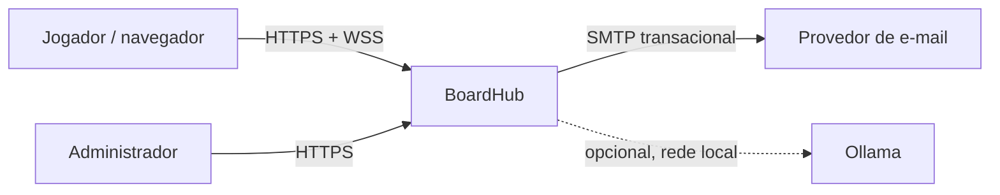
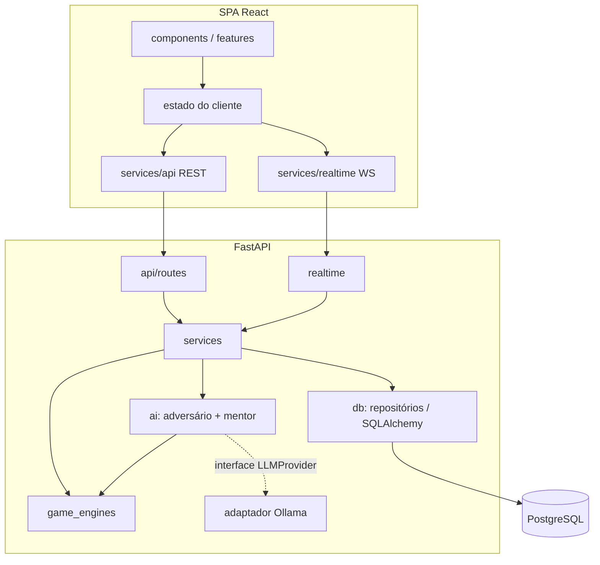
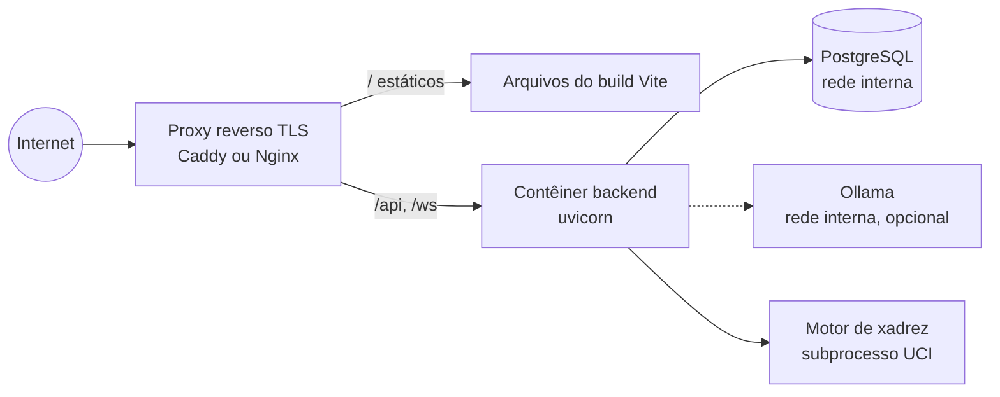

# 04 — Arquitetura Técnica

> Versão 0.2.0 · 2026-10-13 · Estado: **aprovado** (2026-10-13) · Decisão de base: [ADR-0001](adr/ADR-0001-arquitetura-inicial.md)

## 1. Visão geral

**Monólito modular** em duas aplicações: SPA React/TypeScript (Vite) e API FastAPI (Python) com REST + WebSocket, persistência em PostgreSQL via SQLAlchemy/Alembic. Motores de jogo são bibliotecas Python puras, sem I/O. IA generativa (Ollama) é um adaptador opcional atrás de uma interface. Microsserviços foram rejeitados por falta de necessidade concreta (DT-001).

## 2. Diagrama de contexto



## 3. Diagrama de componentes



## 4. Diagrama de implantação (v1)



Somente o proxy expõe portas públicas (443, e 80 para redirecionamento). Banco e Ollama ficam em rede interna.

## 5. Responsabilidades

| Camada | Faz | Não faz |
|--------|-----|---------|
| Frontend | Renderizar, capturar intenção do usuário, feedback otimista **marcado como provisório**, acessibilidade | Decidir legalidade oficial, resultado, rating |
| `api/routes` | HTTP: parse, autenticação, autorização grosseira, mapear erros | Lógica de negócio, SQL |
| `realtime` | Conexões WS, salas, difusão, heartbeat | Validar regras (delegam a `services`) |
| `services` | Casos de uso, transações, autorização por recurso | Detalhes de HTTP ou de SQL bruto |
| `game_engines` | Regras puras, determinísticas, serialização | I/O, banco, rede, aleatoriedade não injetada |
| `ai` | IA adversária (busca), mentor (análise + templates), adaptador LLM | Decidir legalidade/resultado/ranking |
| `db` | Modelos ORM, repositórios, sessão, migrações | Regras de negócio |
| `core` | Configuração, segurança (hash, tokens), logging, erros | Casos de uso |

## 6. Estrutura de pastas proposta

```
boardhub/
├── backend/
│   ├── app/
│   │   ├── main.py            # cria app, registra rotas, middlewares
│   │   ├── core/              # config (pydantic-settings), security, logging, errors
│   │   ├── api/routes/        # auth, users, matches, ranking, academy, admin, health
│   │   ├── realtime/          # gerenciador de conexões, protocolo, salas
│   │   ├── models/            # ORM SQLAlchemy
│   │   ├── schemas/           # Pydantic (entrada/saída) — contratos públicos
│   │   ├── services/          # auth_service, match_service, rating_service, academy_service…
│   │   ├── game_engines/      # base.py (interface), tictactoe/, checkers/, chess/
│   │   ├── ai/                # opponents/, mentor/, llm/ (interface + ollama)
│   │   └── db/                # session, repositories
│   ├── alembic/
│   ├── tests/                 # unit/, integration/, engines/, realtime/
│   └── pyproject.toml
├── frontend/
│   ├── src/
│   │   ├── app/               # roteamento, providers, layout
│   │   ├── components/        # design system (Button, Board, Dialog…)
│   │   ├── features/          # auth, lobby, tictactoe, checkers, chess, academy, ranking, profile
│   │   ├── hooks/
│   │   ├── services/          # cliente REST, cliente WS
│   │   └── styles/            # tokens, temas
│   ├── tests/
│   └── package.json
├── docs/
├── scripts/                   # utilitários (check_docs.py, seed sintético)
├── tests/e2e/                 # Playwright
└── docker-compose.yml
```

**Estado atual (Fase 1):** existem `backend/` (core, db, models, schemas, services e api de identidade/perfil/catálogo/supervisão) e `frontend/` (app, features auth/profile/catalog, services, styles). `game_engines/` e `ai/opponents/` existem apenas para o jogo da velha (Fase 2a); `realtime/` não existe ainda, de propósito — não se criam diretórios vazios para simular arquitetura.

### Regras de dependência (anticiclo)
`api/realtime → services → (game_engines, ai, db) → core`. `game_engines` só depende da biblioteca padrão e de bibliotecas de regras (ex.: python-chess). `ai` depende de `game_engines`, nunca o contrário. `features/*` no frontend não importam umas das outras; o que for comum vai para `components/` ou `services/`. Verificado por RNF-019.

## 7. Interface comum dos motores

```python
class GameEngine(Protocol[State, Move]):
    game_id: str                                    # "tictactoe" | "checkers" | "chess"
    def initial_state(self, options: GameOptions) -> State: ...
    def legal_moves(self, state: State) -> list[Move]: ...
    def apply(self, state: State, move: Move) -> State: ...  # levanta IllegalMove
    def outcome(self, state: State) -> Outcome | None:   ...  # None = em andamento
    def serialize(self, state: State) -> dict: ...         # JSON estável e versionado
    def deserialize(self, data: dict) -> State: ...
    def parse_move(self, raw: str) -> Move: ...            # notação textual do jogo
```
Estado é imutável (ou copiado) para permitir busca da IA sem efeitos colaterais.

## 8. Fluxos de dados

**Lance online:** cliente → WS `submit_move` → `realtime` autentica conexão → `match_service.submit_move` abre transação, `SELECT … FOR UPDATE` na partida → motor valida/aplica → grava `match_moves` + estado → se terminou, `rating_service` atualiza na mesma transação → commit → difusão `move_applied`/`match_ended` para a sala.

**Lance contra IA:** igual ao anterior; após commit, tarefa assíncrona (pool de threads/processos para não bloquear o loop) calcula lance da IA com limite de tempo e o submete pelo mesmo caminho, como jogador `ai`.

## 9. Autenticação e autorização
Sessão por cookie opaco (DT-004), detalhes no [doc 09](09-seguranca-e-privacidade.md). Papéis: `user`, `moderator`, `admin`. Autorização **por recurso** no `services` (ex.: só participantes enviam lances). WebSocket autentica no handshake pelo mesmo cookie e verifica `Origin`.

## 10. Persistência
PostgreSQL; SQLAlchemy 2.x estilo tipado; Alembic para toda mudança de esquema; transações curtas; bloqueio pessimista por partida. Detalhes no [doc 05](05-modelagem-de-dados.md).

## 11. IA local
`ai/llm/provider.py` define `LLMProvider.rephrase(fatos, estilo) -> str | None`. Implementações: `NullProvider` (padrão, devolve `None` e o texto determinístico é usado) e `OllamaProvider` (HTTP para URL interna configurável, timeout curto). Detalhes no [doc 08](08-ia-e-boardhub-academy.md).

## 12. Dependências externas

| Dependência | Uso | Obrigatória? | Falha ⇒ |
|-------------|-----|-------------|---------|
| PostgreSQL | Persistência | Sim | Indisponível (503), readiness falha |
| SMTP | E-mails transacionais | Sim para verificação | Fila de reenvio; contas não verificadas jogam modo não ranqueado |
| Motor de xadrez (UCI) | IA nível alto e análise | Não | Cai para busca própria com python-chess (mais fraca) |
| Ollama | Reformular explicações | Não | Texto determinístico |

## 13. Limites de confiança
1. Navegador ↔ proxy: **não confiável** — toda entrada validada.
2. Proxy ↔ backend: confiável apenas quanto a `X-Forwarded-*` de IPs configurados.
3. Backend ↔ banco/Ollama/motor: rede interna; saídas do Ollama tratadas como **não confiáveis** (texto escapado, sem execução).

## 14. Escalabilidade
v1: 1 instância de backend. Para escalar: (a) estado de salas WS fora do processo via barramento (DT-009); (b) IA em pool de processos ou worker separado; (c) réplica de leitura para ranking/histórico. Nada disso é implementado sem necessidade medida.

## 15. Configuração
Somente variáveis de ambiente (ver [`.env.example`](../.env.example)), carregadas por `pydantic-settings`, validadas na inicialização (falha rápida). Sem segredos no código ou no `docker-compose.yml`.

## 16. Decisões e alternativas rejeitadas
Ver [doc 16](16-decisoes-tecnicas.md): microsserviços (rejeitado), Node no backend (rejeitado: Python facilita IA e python-chess), JWT stateless (rejeitado para sessões web), GraphQL (rejeitado: escopo REST simples), Socket.IO (rejeitado: WS nativo basta).
